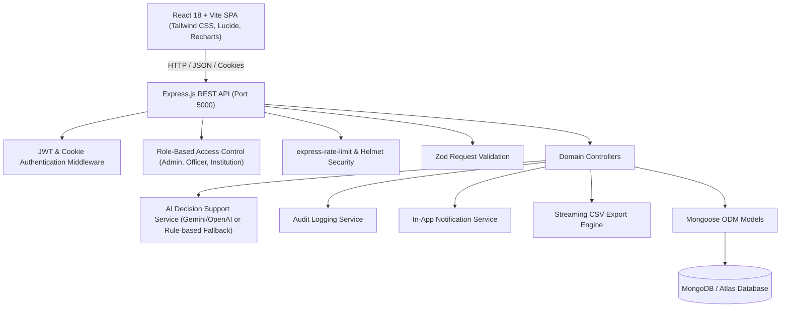
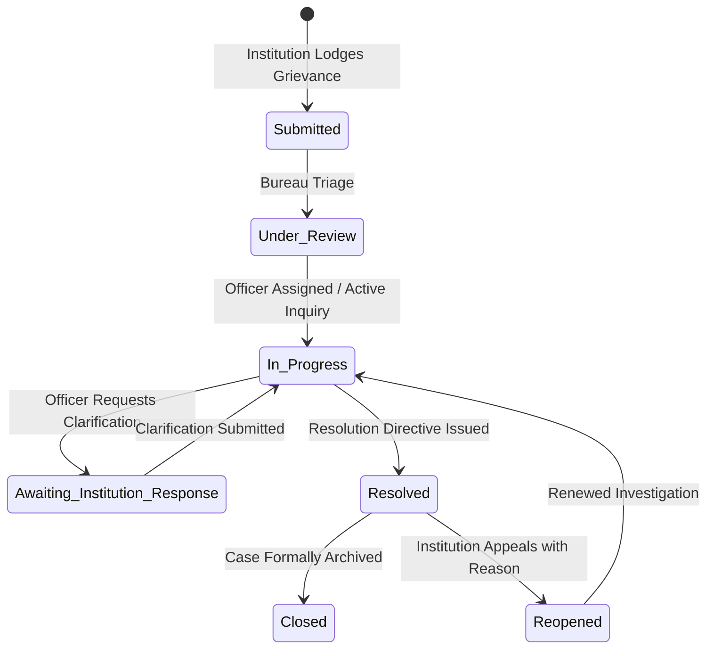

# AICTE Complaint Monitoring & Tracking System — Technical Architecture (SIH26264)

## 1. System Architecture

## 2. Core Entities & Database Models

1. **User**: Authentication, role (`admin`, `officer`, `institution`), bureau/cell association, institution link, bcrypt password hash.
2. **Institution**: AICTE Permanent ID (`1-XXXXXXXXX`), approved institution name, state, district, technical type.
3. **Department**: AICTE specialized bureaus (Approval Bureau, Grievance Cell, Finance Bureau, Student Development Cell, etc.), target SLA days, handled categories.
4. **Complaint**: Unique generated ID (`AICTE-2026-XXXXX`), title, description, category, priority, status, deadline, overdue state, AI confidence, attachment metadata.
5. **ComplaintMessage**: Public clarifications vs. confidential internal officer notes (`isInternal: true`), strictly partitioned from institution visibility.
6. **ComplaintStatusHistory**: Complete immutable chronological milestone trail of all transitions.
7. **Notification**: User-specific in-app alerts with read/unread tracking.
8. **AuditLog**: Complete system activity ledger.

## 3. Complaint Lifecycle State Machine

## 4. Multi-Tenant Data Isolation

- **Institution Users**: Backend strictly injects `{ institution: req.user.institution }` on every query. Internal officer notes (`isInternal: true`) are systematically excluded from query projections.
- **Department Officers**: Scoped to their authorized bureau code/id (`{ department: req.user.department }`). Can inspect public documents and author confidential internal notes.
- **Administrators**: Cross-bureau access, capable of reassigning cases, auditing performance, modifying targets, and exporting compliance data.

## 5. AI Assistance Architecture

- **Category Suggestion**: NLP analysis maps grievance text to appropriate AICTE domain categories.
- **Dynamic Priority & Rationale**: Identifies urgency triggers (e.g. anti-ragging, immediate admission cutoff, financial fraud) and assigns priority with full transparency explanations.
- **Precedent Matching**: Tokenized similarity scoring against existing complaints for quick deduplication.
- **Officer Briefing Generator**: Generates 3-bullet executive briefings.
- **Zero-Dependency Fallback**: System functions 100% offline without any third-party API key required.
